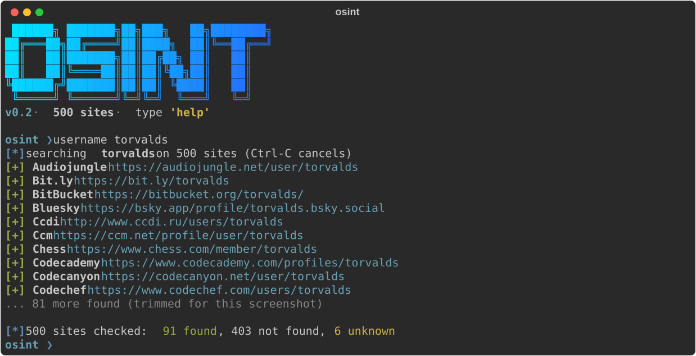

# osint

Terminal OSINT toolkit: username search across **500 sites**, email recon and domain/IP recon, in an interactive shell or as one-shot commands.



> Use it on yourself, in CTFs, or with explicit authorization. See [Legal and ethics](#legal-and-ethics).

## Features

- **Username search** on 500 sites. The site list is derived from [maigret](https://github.com/soxoj/maigret)'s database and pruned against the live internet: every shipped site was checked with random nonsense usernames and none reports a false "found".
- **Email recon** with free sources and no API keys: XposedOrNot breaches, [holehe](https://github.com/megadose/holehe) account checks, Gravatar and GitHub profiles, MX and mail provider detection.
- **Domain / IP recon**: whois, DNS records, subdomains from certificate transparency (crt.sh), reverse DNS and geolocation for IPs.
- **Interactive shell** (`osint ❯`) with history and tab completion, or **one-shot** commands with `--json` output.
- **Markdown reports** (`save`), never overwriting an earlier report.
- Ctrl-C cancels the running scan, not the program; partial results are kept.

## Install

Requires Python 3.10 or newer.

```bash
git clone https://github.com/YCistak/osint.git
cd osint

# with uv (recommended)
uv venv .venv && uv pip install --python .venv/bin/python -e .

# or with pip
python3 -m venv .venv && .venv/bin/pip install -e .

.venv/bin/osint
```

`./run.sh` does the same setup on first run and then starts the shell.

## Usage

### Interactive shell

```text
$ osint
 ██████╗ ███████╗██╗███╗   ██╗████████╗
██╔═══██╗██╔════╝██║████╗  ██║╚══██╔══╝
██║   ██║███████╗██║██╔██╗ ██║   ██║
██║   ██║╚════██║██║██║╚██╗██║   ██║
╚██████╔╝███████║██║██║ ╚████║   ██║
 ╚═════╝ ╚══════╝╚═╝╚═╝  ╚═══╝   ╚═╝
v0.2 · 500 sites · type 'help'

osint ❯ username torvalds
```

| Command | What it does |
|---|---|
| `username <name>` | Search a username on all sites |
| `email <address> [--unsafe] [--all-modules]` | Breaches, registered accounts, profiles, mail server |
| `domain <domain\|ip>` | Whois, DNS, subdomains (domain) or reverse DNS and geolocation (IP) |
| `save [path]` | Save the last result as Markdown (default: `./reports/`) |
| `show all\|found` | Re-display the last result; `all` also lists not-found and unknown sites |
| `help`, `clear` | Help text, clear the screen |
| `exit`, `quit`, Ctrl-D | Leave |

Output markers: `[+]` found (green), `[-]` not found (red, hidden unless `show all`), `[?]` unknown (yellow), `[*]` info and progress (blue). Sites that could not be checked (blocked, rate limited, timeout) are counted in the summary instead of flooding the screen.

### One-shot

```bash
osint username torvalds                 # live hits, then totals
osint username torvalds --show-all      # include not found / unknown
osint email jane@example.com            # grouped sections
osint email jane@example.com --unsafe   # also run password-reset checks (see below)
osint domain example.com
osint domain 1.1.1.1
osint domain example.com --json         # machine-readable, no banner or progress
osint username torvalds --save          # also write ./reports/username-torvalds-<date>.md
osint --no-banner                       # shell without the banner
```

Exit codes: `0` ok, `2` invalid input, `130` scan cancelled.

### Email output

```text
[*] Breaches
[*] Registered accounts
[*] Profiles
[*] Mail server
[*] Tip: run 'username <localpart>' to search the local part as a username.
```

- **Breaches**: XposedOrNot breach list with risk score and password exposure; the terminal shows the 15 newest, reports and `--json` keep all.
- **Registered accounts**: holehe results. Three groups of holehe modules are skipped by default:
  - the 4 *password reset* modules (`adobe`, `mail_ru`, `odnoklassniki`, `samsung`) because they can trigger a real email to the target. `--unsafe` includes them.
  - adult-category modules (never run).
  - modules that never gave a usable answer in our measurements (65 of 113, see `scripts/measure_email_modules.py`). `--all-modules` includes them.
- **Profiles**: Gravatar profile (SHA-256 of the address) and GitHub user search by public email (unauthenticated, limited to 10 searches per minute).
- **Mail server**: MX records and provider detection via dnspython.

## Data sources and credits

| Source | Used for | Notes |
|---|---|---|
| [maigret](https://github.com/soxoj/maigret) (MIT) | Site database for username search | `scripts/update_sites.py` converts and prunes its `data.json`; we only read it as data and implement our own checker for its `checkType` values (`status_code`, `message`, `response_url`), `urlProbe`, `headers`, `regexCheck` and `errors` |
| [holehe](https://github.com/megadose/holehe) | Email account checks | Installed as a library |
| [XposedOrNot](https://xposedornot.com) | Breach check and analytics | Free API, no key |
| [Gravatar](https://gravatar.com) | Public profile by email hash | No key |
| GitHub search API | User lookup by public email | No key, rate limited |
| [crt.sh](https://crt.sh) | Subdomains from certificate transparency | Often slow or busy |
| [ip-api.com](https://ip-api.com) | IP geolocation | Free tier, HTTP only, non-commercial use |

Thank you to the maigret maintainers and contributors: the site database is the heart of the username search.

## Keeping the site list healthy

```bash
python scripts/update_sites.py            # regenerate osint/sites.json from maigret's latest data.json
python scripts/validate_sites.py          # scan nonsense usernames + each site's known account
python scripts/validate_sites.py --write --drop-blind   # prune false positives and blind sites
```

`scripts/blocklist.txt` records every removed site so regenerating keeps the pruning.

## Development

```bash
uv pip install --python .venv/bin/python -e ".[test]"
.venv/bin/python -m pytest              # offline tests
.venv/bin/python -m pytest -m live      # tests that use the real internet
```

## Known limitations

- Username results are heuristics: a profile page that exists is not proof the account belongs to the person you are looking for, and some sites change their pages without notice.
- Sites behind bot protection answer "unknown" from some networks.
- holehe's coverage decays as services change; the dead-module list reflects one network at one point in time.
- GitHub's unauthenticated search allows 10 requests per minute; crt.sh and ip-api.com may throttle.

## Legal and ethics

This tool is meant for **auditing your own digital footprint, CTF competitions and authorized research**. Collecting data about other people without a lawful basis can violate privacy laws (GDPR, KVKK, CFAA and similar). You are responsible for how you use it. Do not use it for stalking, harassment or unauthorized profiling. The `--unsafe` email checks can send real password-reset emails to the target; use them only on addresses you own.

## License

MIT, see [LICENSE](LICENSE). Site data derived from maigret (MIT).
