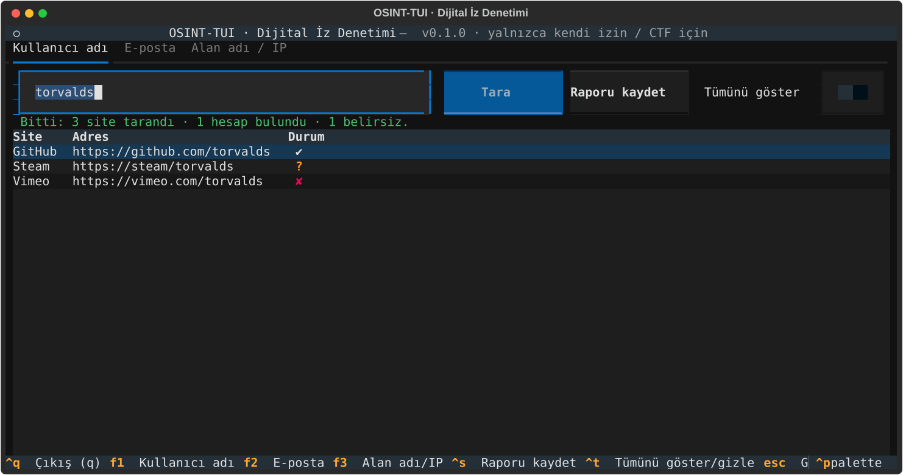

# osint-tui

Kişisel dijital iz denetimi ve CTF öğrenimi için terminal arayüzlü (TUI) bir OSINT aracı.
Python + [Textual](https://textual.textualize.io/) ile yazıldı; üç sekmesi var.



## Kurulum

```fish
cd ~/osint-tui
uv venv .venv
uv pip install -e ".[test]"
```

`uv` yoksa: `python -m venv .venv; .venv/bin/pip install -e ".[test]"`

## Çalıştırma

```fish
./calistir.sh              # ilk çalıştırmada .venv'i kendisi kurar
# veya
.venv/bin/osint-tui
```

### Tuşlar

| Tuş | İşlev |
|---|---|
| `F1` / `F2` / `F3` | Sekmeler arası geçiş |
| `Enter` | Sorguyu başlat |
| `Ctrl+S` | Aktif sekmenin raporunu kaydet |
| `Ctrl+T` | "Tümünü göster" anahtarını aç/kapat (kullanıcı adı, e-posta) |
| `Esc` | Giriş kutusundan çık |
| `q` | Çıkış (giriş kutusuna odaklı değilken) |
| `Ctrl+Q` | Her durumda çıkış |

## Modüller

### 1. Kullanıcı adı
Kullanıcı adını 37 sitede aynı anda (en çok 20 eşzamanlı istek, 8 sn zaman aşımı) arar.
Sonuçlar tabloya canlı düşer: `✔` bulundu, `✘` yok, `?` belirsiz (engel, istek sınırı, zaman aşımı).
Varsayılan olarak yalnızca bulunanlar gösterilir; "Tümünü göster" anahtarıyla hepsi görünür.

Site listesi `osint_tui/siteler.json` dosyasındadır; her kayıt bir URL şablonu (`{}` yerine kullanıcı adı gelir)
ve bir tespit yöntemi içerir: `durum` (HTTP 200/404), `bulunamadi_metni` veya `bulundu_metni`.
Doğruluk sayıdan önemlidir: bot doğrulaması çıkaran veya var olmayan adda da "200" dönen siteler
(Instagram, X, TikTok, Pinterest, Kaggle…) bilerek listede yoktur. Yeni site eklerken mutlaka
anlamsız bir adla (ör. `zq8xkv3pp91ww`) deneyip yanlış pozitif olmadığını doğrulayın.

### 2. E-posta
[holehe](https://github.com/megadose/holehe) kütüphanesiyle e-postanın hangi servislerde kayıtlı olduğuna bakar.
- "Şifremi unuttum" akışı tetikleyen 4 servis (Adobe, Mail.ru, Odnoklassniki, Samsung) hedefe e-posta gitmesin diye **atlanır**.
- İstek sınırına takılan veya yanıt vermeyen servisler `?` olarak gösterilir.
- Veri sızıntısı kontrolü için [haveibeenpwned.com](https://haveibeenpwned.com) adresine elle bakın (ücretli API anahtarı kullanılmaz).

### 3. Alan adı / IP
- **Alan adı:** whois (python-whois), DNS kayıtları (A, AAAA, MX, NS, TXT — dnspython) ve crt.sh sertifika
  kayıtlarından tekilleştirilmiş alt alan adları.
- **IP adresi:** ters DNS (PTR) ve ip-api.com üzerinden temel coğrafi konum (anahtarsız, ücretsiz).

### Raporlar
Her sekmedeki **Raporu kaydet** düğmesi (veya `Ctrl+S`) Markdown dosyasını
`~/osint-tui/raporlar/<tür>-<hedef>-<tarih>.md` olarak yazar. Aynı adlı dosyanın üzerine yazılmaz.

## Testler

```fish
.venv/bin/python -m pytest              # ağ gerektirmeyen testler (başsız Textual + sahte ağ)
.venv/bin/python -m pytest -m canli     # gerçek ağ duman testleri (github/torvalds, example.com DNS)
```

## Bilinen sınırlamalar
- Siteler arayüzlerini değiştirebilir; bir sonuç yanlış görünürse listeyi güncelleyin.
- holehe modüllerinin önemli bir kısmı güncel değildir; birçok servis `?` döner. `?` "kayıt yok" demek değildir.
- crt.sh sık sık yoğun olur (HTTP 502 / zaman aşımı); bu durumda tekrar deneyin.
- ip-api.com ücretsiz sürümü yalnızca HTTP destekler ve dakikada ~45 istekle sınırlıdır.
- Konum bilgisi (IP) yaklaşıktır, çoğunlukla servis sağlayıcının merkezini gösterir.

## Yasal not
Bu araç kişinin **kendi dijital izini araştırması** ve **CTF/eğitim** amaçlıdır.
Başkası hakkında izinsiz bilgi toplayıp dosya hazırlamak KVKK (6698 sayılı Kanun) ve
Türk Ceza Kanunu madde 136 (verileri hukuka aykırı olarak verme veya ele geçirme)
kapsamına girebilir. Kullanımın sorumluluğu size aittir.
